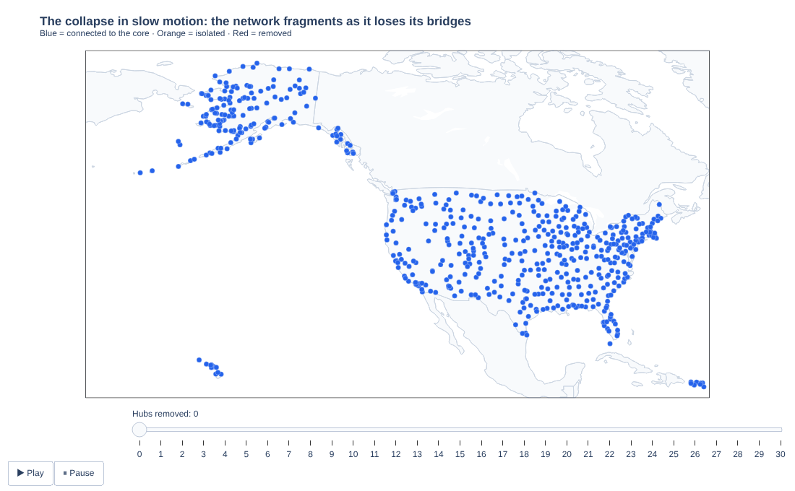
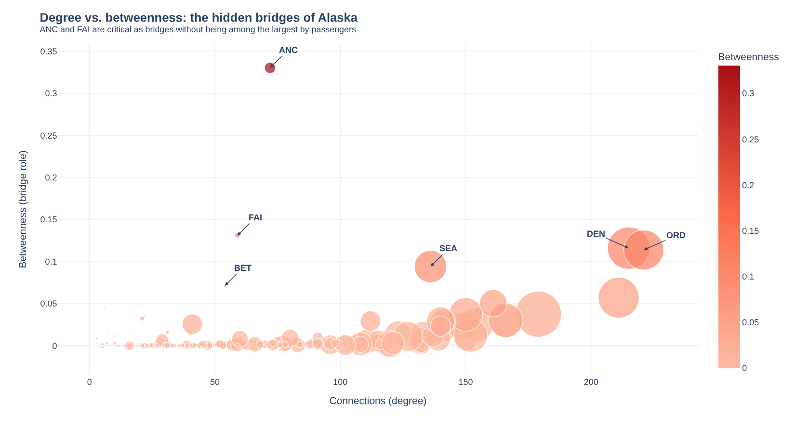
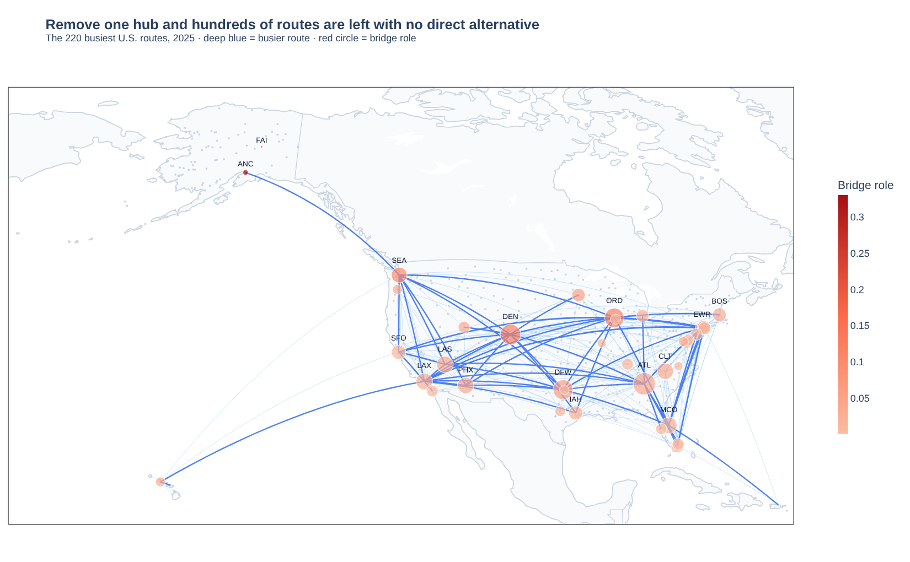
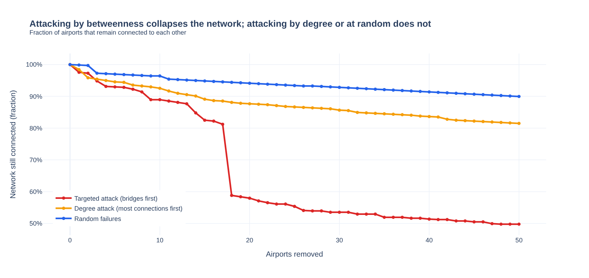

# Resilience of the U.S. Passenger Air Network (2025)

**Which airports are so critical that their failure would fragment the U.S. air network?**
A graph analysis of 697 airports and 8,375 routes, built with Python, NetworkX and Plotly.



<sub>Removing the 30 airports with the highest betweenness, one at a time. Blue = still connected to the core, orange = isolated, red = removed. [Interactive version](docs/07_collapse_animation.html).</sub>

---

## Key findings

1. **Big is not the same as critical.** Atlanta (88.6M passengers), Denver (75.4M) and Dallas-Fort Worth (70.3M) carry the most traffic, but the airports with the highest *betweenness* (the ones that act as bridges between other airports) are **Anchorage (ANC, 0.330)** and **Fairbanks (FAI, 0.131)**, far ahead of Denver (0.116) and Chicago O'Hare (0.114).
2. **Hidden bridges.** ANC and FAI have only 72 and 59 connections, versus 221 for Chicago O'Hare and 215 for Denver. A ranking by passengers or by number of routes would miss them. They are the main gateways between many remote Alaskan airports and the rest of the network.
3. **The network is robust to random failures but fragile to targeted ones.** After removing 40 airports, the largest connected component still holds:

| Scenario (40 airports removed) | Airports still connected to each other |
|---|---|
| Random failures | **91.4%** |
| Attack on the highest-degree hubs | **83.6%** |
| Attack on the highest-betweenness bridges | **51.4%** |

Under the betweenness attack there is a sharp cliff around the 18th removal (81% to 59% connected).

---

## The decision question

Identifying the nodes whose loss fragments the network lets an airline, an insurer or an infrastructure planner decide where to invest in **redundancy and resilience**.

## Data

| Item | Detail |
|---|---|
| Routes | [BTS T-100 Domestic Segment (All Carriers)](https://www.transtats.bts.gov/), year 2025. Public domain. |
| Coordinates | [OpenFlights](https://github.com/jpatokal/openflights) airport database, joined by IATA code. ODbL license. |

Raw data is not stored in this repo. See [`data/README.md`](data/README.md) for how to download it.

## Method

1. **Clean:** keep scheduled passenger service (`CLASS == "F"`) that actually operated (`DEPARTURES_PERFORMED > 0`, `PASSENGERS > 0`) and drop self-loops. This takes 458,361 raw rows down to 342,524.
2. **Build the graph:** each airport is a node, each route an edge weighted by yearly passengers. Directed routes (13,715) are collapsed into undirected ones (8,409), since A to B and B to A are the same connection for connectivity purposes.
3. **Keep the main connected component:** 697 of 718 airports and 8,375 routes. The other 21 airports sit in small disconnected clusters.
4. **Measure each airport:** degree (how many airports it connects to), passengers (how big it is) and betweenness centrality (how often it sits on shortest paths between other airports).
5. **Stress test:** remove 50 airports one by one under three orderings (by betweenness, by degree, at random) and track the fraction of airports that remain in the largest connected component.
6. **Rank:** a combined criticality index, `0.6 × normalized betweenness + 0.4 × normalized degree`.

## Results

### Degree vs. betweenness: the hidden bridges



### The backbone of the network

The 220 busiest routes, with hubs sized by passengers and colored by bridge role.



### What happens when hubs fail



### Top 10 airports by criticality index

| # | Airport | Degree | Passengers (M) | Betweenness | Criticality |
|---|---|---|---|---|---|
| 1 | ANC, Anchorage | 72 | 5.2 | 0.330 | 0.73 |
| 2 | ORD, Chicago O'Hare | 221 | 67.2 | 0.114 | 0.61 |
| 3 | DEN, Denver | 215 | 75.4 | 0.116 | 0.60 |
| 4 | DFW, Dallas-Fort Worth | 211 | 70.3 | 0.057 | 0.49 |
| 5 | SEA, Seattle-Tacoma | 136 | 44.1 | 0.094 | 0.42 |
| 6 | ATL, Atlanta | 179 | 88.6 | 0.037 | 0.39 |
| 7 | MSP, Minneapolis-St. Paul | 161 | 31.5 | 0.050 | 0.38 |
| 8 | LAS, Las Vegas | 166 | 49.6 | 0.030 | 0.36 |
| 9 | CLT, Charlotte | 166 | 47.3 | 0.029 | 0.35 |
| 10 | FAI, Fairbanks | 59 | 1.1 | 0.131 | 0.34 |

**Takeaway:** a resilience strategy needs to protect two different things. Large hubs like Atlanta protect **passenger volume**, while bridges like Anchorage protect the **reach of the network**.

## Interactive charts

Every figure is also available as a standalone interactive page in [`docs/`](docs/index.html) (hover, zoom, play the animation). If you enable GitHub Pages for this repo (Settings, Pages, deploy from `main` and `/docs`), they will be served at `https://jmartinezvogel.github.io/us-airline-network-resilience/`.

## Reproduce it

```bash
git clone https://github.com/jmartinezvogel/us-airline-network-resilience.git
cd us-airline-network-resilience

python -m venv .venv
source .venv/bin/activate        # Windows: .venv\Scripts\activate
pip install -r requirements.txt

# 1. Download the BTS T-100 CSV into data/ (see data/README.md)
python scripts/check_data.py

# 2. Run the notebook from its own folder
cd notebooks
jupyter lab us_airline_network_resilience.ipynb
```

Running the notebook also regenerates the interactive HTML files in `docs/`. Set `EXPORT_HTML = False` in the setup cell to turn that off.

## Repo structure

```
.
├── notebooks/
│   └── us_airline_network_resilience.ipynb   # full analysis, with outputs
├── docs/                                     # interactive Plotly figures (HTML)
├── assets/                                   # static images and GIF used in this README
├── data/
│   └── README.md                             # how to get the data (CSV is not committed)
├── scripts/
│   └── check_data.py                         # validates the downloaded CSV
├── requirements.txt
└── LICENSE
```

## Limitations

- **U.S. carriers only.** The network is domestic and regional, not global. International and foreign-carrier routes are not included.
- **Static snapshot.** One year of aggregated data (2025), not real-time operations or seasonal changes.
- **Connectivity, not capacity.** Betweenness is computed on unweighted shortest paths, so it measures topology and not how many seats or flights a route can absorb when another one fails. A node "failing" means removing the airport entirely.
- **Judgment calls.** The 60/40 weighting in the criticality index is a design choice, not an estimated parameter. The key conclusion (bridges matter beyond size) does not depend on the exact weights, but the exact ranking does.
- **Map coverage.** 603 of the 697 airports have coordinates in OpenFlights, so maps show those; all 697 are used in the network metrics.
- **Reproducibility.** The random-failure scenario uses a fixed seed (`default_rng(7)`).

## Sources

- Bureau of Transportation Statistics. *T-100 Domestic Segment (U.S. Carriers)*, 2025. U.S. Department of Transportation.
- OpenFlights. *Airport database*. [Open Database License](https://opendatacommons.org/licenses/odbl/1-0/).
- Libraries: pandas, NumPy, NetworkX, Plotly.

## About

Final project for the Data Visualization course of the Master in Applied Artificial Intelligence (MNA) at Tec de Monterrey, by **Jaime Alfonso Martínez Vogel**. Claude (Anthropic) was used as an AI assistant for visualization design; results were verified against the real data.

Code is released under the [MIT License](LICENSE). Data sources keep their own licenses.
